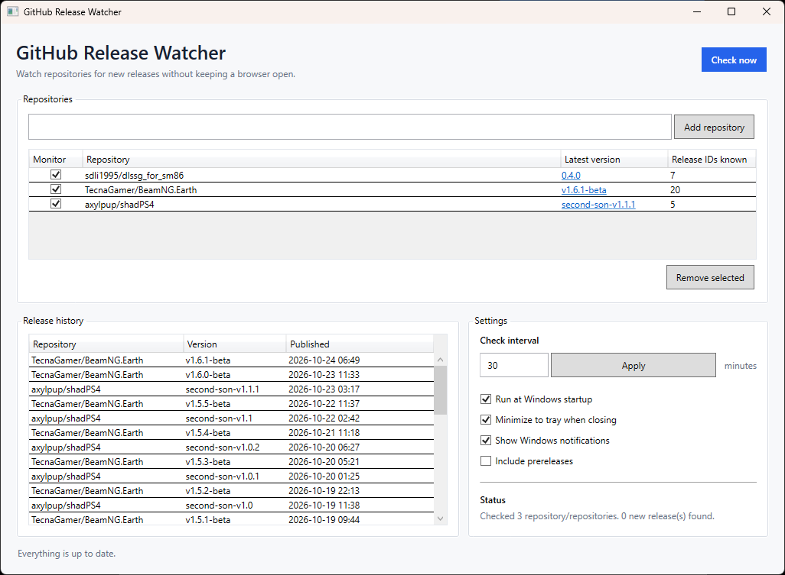

# GitHub Release Watcher

A lightweight Windows desktop application that monitors GitHub
repositories for new releases and notifies you when updates are
available.

Track multiple repositories from one place, review release history, and
keep monitoring in the background from the Windows system tray.



## Features

-   **Multi-repository monitoring** --- add public GitHub repositories
    using `owner/repo` or a repository URL.
-   **Configurable polling** --- choose an automatic check interval from
    1 minute to 24 hours.
-   **Check now** --- manually check all enabled repositories at any
    time.
-   **Release history** --- review detected releases, including
    repository, version/tag, and publication date.
-   **Direct release links** --- open a release page from the
    application.
-   **Windows notifications** --- receive system-tray balloon
    notifications when new releases are detected.
-   **System-tray integration** --- minimize the application to the tray
    and control monitoring from the tray menu.
-   **Run at startup** --- optionally launch the application when you
    sign in to Windows.
-   **Prerelease filtering** --- choose whether prereleases are included
    in monitoring.
-   **Persistent local settings** --- save repository lists,
    preferences, and release history between sessions.

## Download

**Windows 10/11 (64-bit)**

Download the latest **self-contained Windows x64 executable** from the
[GitHub Releases
page](https://github.com/evilhny/Github-Release-Watcher/releases).

The self-contained build includes the .NET runtime, so you do not need
to install .NET separately. Download `GitHubReleaseWatcher.exe` from the
release assets and run it on a compatible 64-bit Windows PC.

## Requirements

### To run the published application

-   Windows 10 or Windows 11 (64-bit)
-   Internet access to `api.github.com`

No separate .NET installation is required for the self-contained
release.

### To build from source

-   Windows 10 or Windows 11 (64-bit)
-   [.NET 10
    SDK](https://dotnet.microsoft.com/en-us/download/dotnet/10.0)
-   Internet access to `api.github.com`

## Build and run from source

1.  Install the .NET 10 SDK.

2.  Clone the repository:

    ``` powershell
    git clone https://github.com/evilhny/Github-Release-Watcher.git
    ```

3.  Open the project directory:

    ``` powershell
    cd Github-Release-Watcher
    ```

4.  Restore dependencies and run the application:

    ``` powershell
    dotnet restore
    dotnet run
    ```

## Publish a self-contained Windows executable

To create a self-contained, single-file Windows x64 build, run:

``` powershell
dotnet publish -c Release -r win-x64 --self-contained true -p:PublishSingleFile=true -p:IncludeNativeLibrariesForSelfExtract=true
```

The published files will be placed under:

``` text
bin\Release\net10.0-windows\win-x64\publish\
```

The executable is named `GitHubReleaseWatcher.exe`.

This build includes the .NET runtime, so users do not need to install it
separately. The self-contained executable is larger than a
framework-dependent build.

## How release detection works

1.  Add the repositories you want to monitor.
2.  The first successful scan establishes a baseline for each
    repository.
3.  Existing releases are added to the history without triggering
    notifications.
4.  During subsequent scans, newly detected releases are added to the
    history and can trigger notifications.
5.  The application continues monitoring at the configured interval
    while it is running.

## Important behavior and limitations

-   **Release lookup window:** The application requests the latest 20
    releases per repository. If more than 20 releases are published
    between scans, some releases may be missed.
-   **API rate limits:** Public repository requests do not require a
    GitHub token. Unauthenticated requests are subject to GitHub's API
    rate limits. Very short polling intervals across many repositories
    may exhaust the available limit.
-   **Prereleases:** The prerelease setting determines whether
    prereleases are included in monitoring.
-   **Notifications:** Notifications use the Windows system-tray balloon
    mechanism. Windows settings and the Windows version may affect
    whether they appear.
-   **Background behavior:** When the minimize-to-tray option is
    enabled, closing the main window hides the application instead of
    stopping it. Use **Exit** from the tray menu to stop monitoring
    completely.
-   **Internet connection:** The application needs internet access to
    check GitHub releases.

## Data and privacy

Application settings and release history are stored locally at:

``` text
%LOCALAPPDATA%\GitHubReleaseWatcher\settings.json
```

Monitoring public repositories does not require a GitHub token or
account credentials. The application makes requests to GitHub's API to
retrieve release information.

## Technology

-   C#
-   WPF (Windows Presentation Foundation)
-   .NET 10
-   GitHub REST API
-   Hardcodet.Wpf.TaskbarNotification

## Contributing

Bug reports, suggestions, and improvements are welcome. If you encounter
a problem, open an issue in the [GitHub
repository](https://github.com/evilhny/Github-Release-Watcher).

## License

This project is licensed under the MIT License. See the
[LICENSE](LICENSE) file for details.
